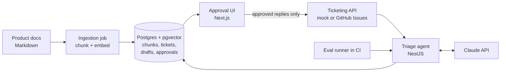

# Architecture

What happens to one ticket:

1. A new ticket appears in the ticketing API and the backend picks it up.
2. The triage agent asks the model to classify it (category, priority, sentiment).
3. The agent searches the doc chunks for the passages closest to the question.
4. The model drafts a reply using only those passages, with citations. The draft is saved as `pending_review`.
5. A support agent reviews it in the approval UI and approves, edits or rejects it.
6. Only an approved draft is posted back to the ticket. Every step is logged.

## Repository layout

| Path        | What lives there                                                       |
| ----------- | ---------------------------------------------------------------------- |
| `apps/api`  | NestJS backend: ingestion, triage agent, ticketing adapters, approvals |
| `apps/web`  | Next.js review queue                                                   |
| `packages/` | Shared code (types, eval runner) as later phases need it               |
| `infra/db`  | Database init scripts                                                  |
| `docs/`     | Architecture, decisions (ADRs), and later the runbook                  |
